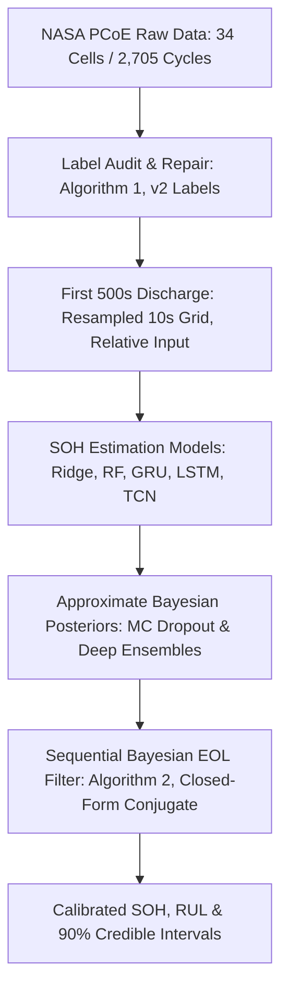

# Uncertainty-Aware Battery Health Prognostics for Autonomous Underwater Vehicles (AUVs)

<p align="center">
  <strong>A Label-Audited, Leakage-Safe Study with Bayesian Inference</strong><br>
  <em>IEEE Journal of Oceanic Engineering (Manuscript Submitted for Review)</em>
</p>

<p align="center">
  <a href="https://www.python.org/downloads/release/python-3100/"></a>
  <a href="https://pytorch.org/"></a>
  <a href="https://www.gbu.ac.in/"></a>
  <a href="LICENSE"></a>
  <a href="https://data.nasa.gov/"></a>
  <a href="https://github.com/psf/black"></a>
</p>

---

## 📑 Contents

- [Context and Motivation](#context-and-motivation)
- [Key Contributions](#key-contributions)
- [System Architecture & Pipeline](#system-architecture--pipeline)
- [Data Provenance & Label Audit (Algorithm 1)](#data-provenance--label-audit-algorithm-1)
- [Strict Leakage-Safe Cell-Wise Split](#strict-leakage-safe-cell-wise-split)
- [Model Zoo & Mathematical Formulation](#model-zoo--mathematical-formulation)
  - [Reference-Anchored Input](#reference-anchored-input)
  - [Deep & Classical Models](#deep--classical-models)
  - [Approximate Bayesian Inference for SOH](#approximate-bayesian-inference-for-soh)
  - [Sequential Bayesian EOL Estimation (Algorithm 2)](#sequential-bayesian-eol-estimation-algorithm-2)
- [Quantitative Benchmark Results](#quantitative-benchmark-results)
  - [Effect of Label Repair (v1 vs. v2)](#effect-of-label-repair-v1-vs-v2)
  - [SOH Estimation on 9 Unseen Test Cells](#soh-estimation-on-9-unseen-test-cells)
  - [Calibration of SOH Predictive Distributions](#calibration-of-soh-predictive-distributions)
  - [RUL Prognostics on Test Cell B0018](#rul-prognostics-on-test-cell-b0018)
  - [Leave-One-Cell-Out (LOCO) Cross-Validation](#leave-one-cell-out-loco-cross-validation)
  - [Input Window Sensitivity & Edge Hardware Latency](#input-window-sensitivity--edge-hardware-latency)
- [Repository Layout](#repository-layout)
- [Installation and Reproducibility](#installation-and-reproducibility)
- [Authors & Affiliations](#authors--affiliations)
- [Citation](#citation)

---

## Context and Motivation

Autonomous underwater vehicles (AUVs) carry all of their energy on board, predominantly in lithium-ion battery packs. If a pack ages faster than anticipated, mission duration drops drastically, or at worst, the vehicle is stranded subsea far from recovery.

Predicting battery health in oceanic environments presents distinct engineering hurdles:
1. **Hostile Thermal Regimes**: Seawater at depth is cold, often only a few degrees Celsius (4°C), substantially altering charge-transfer kinetics, internal resistance, and degradation rates compared to automotive or laboratory conditions.
2. **Severely Constrained Resources**: Onboard edge compute and wireless acoustic communications are strictly limited, requiring compact models capable of generating rapid, dependable estimates from short operational windows.
3. **Flawed Common Benchmarks & Data Leakage**: In existing battery prognostics literature, models are often evaluated on random window splits (where adjacent windows from the same cell appear in both training and test sets, measuring cell recognition rather than physical aging) or on un-audited benchmarks where label noise, preliminary formation cycles, and sensor dropouts corrupt the target state of health (SOH) and remaining useful life (RUL).

This repository implements the complete, label-audited, leakage-safe experimental framework described in our research manuscript, evaluating 33 usable cells from the NASA Prognostics Center of Excellence (PCoE) across classical and deep models with calibrated Bayesian uncertainty quantification.

---

## Key Contributions

- **Audited Label Repair (Algorithm 1)**: Demonstrated that standard first-cycle initial capacity ($C_0$) and first-crossing EOL detection fail on the NASA benchmark (in original v1 labels, 12 of 33 cells had all-zero RUL at every cycle, including 4 of 9 test cells). Developed a principled, automated label repair protocol that eliminates formation artifacts, sensor failures, and false RUL zeros.
- **Strict Leakage-Safe Cell-Wise Evaluation**: All evaluations enforce zero cross-cell leakage across 33 cells (15 training, 9 validation, 9 unseen testing cells) across 4 temperature regimes (4°C, 22°C, 24°C, and 43°C).
- **Early-Window Commissioning Reference**: Standardized input using only the first 500 seconds of discharge relative to the cell's own first 3 cycles, eliminating the need to record complete 3,500s discharge cycles.
- **Uncertainty Quantification**: Rigorous comparison of Monte Carlo (MC) Dropout, Deep Ensembles, and Gaussian residual bounds evaluating negative log-likelihood (NLL), prediction interval coverage probability (PICP), and mean prediction interval width (MPIW).
- **Sequential Bayesian End-of-Life Filter (Algorithm 2)**: A closed-form, Kalman-style recursive Bayesian filter converting SOH streams into an EOL/RUL posterior with credible intervals, validated both on unseen test cell B0018 and via Leave-One-Cell-Out (LOCO) cross-validation across all pre-EOL cells.

---

## System Architecture & Pipeline



---

## Data Provenance & Label Audit (Algorithm 1)

### The v1 Benchmark Defect
In the original NASA PCoE v1 labels:
- $C_0$ was computed naively as the mean of the first three recorded discharges.
- $k^*$ was identified as the first cycle at or below the threshold.

Many cells begin with preliminary or formation discharge cycles where capacity is far below working capacity (0.06–1.0 Ah before stepping up to 1.7–1.8 Ah). Naive rules caused the initial cycle to be classified as already "below threshold," producing:
- **12 of 33 cells with an all-zero RUL at every cycle** (including 4 out of 9 test cells).
- **67% of all test windows having RUL = 0**.
- 43-cycle sensor dropout plateaus (0.06 Ah) and isolated spikes (> 2.2 Ah) corrupting variance (0.091 in v1 vs. 0.006 in v2).

### Algorithm 1: Principled Label Repair
For each cell's discharge capacity series $C_1, \dots, C_n$:
1. Determine working capacity peak: $P \leftarrow \max \{ C_i : i \le 15, C_i \le 2.2\text{ Ah} \}$.
2. Determine start of working life: $s_0 \leftarrow \text{first } i \text{ with } C_i \ge 0.9 P$.
3. Compute initial capacity: $C_0 \leftarrow \text{median}(C_{s0}, C_{s0+1}, C_{s0+2})$.
4. Filter invalid cycles: Keep cycle $i \iff i \ge s_0 \text{ and } 0.35 C_0 \le C_i \le 1.30 C_0$.
5. Compute SOH on kept cycles: $\text{SOH}_i \leftarrow \min(C_i / C_0, 1.0)$, re-indexing cycles $0, 1, \dots$.
6. Robust EOL Threshold: $\theta \leftarrow C_{\text{thr}}/C_0$ if an absolute threshold is given ($1.40\text{ Ah}$ for B0005, B0006, B0018; $1.50\text{ Ah}$ for B0007), else $\theta = 0.70$.
7. End-of-life cycle $k^* \leftarrow \text{first kept index with three consecutive cycles where } \text{SOH} \le \theta$ (mitigating capacity regeneration spikes).
8. Target RUL: $\text{RUL}_k \leftarrow \max(0, k^* - k)$ if $k^*$ exists, else undefined (right-censored for healthy cells).

---

## Strict Leakage-Safe Cell-Wise Split

Cell B0052 contains only 4 cycles and cannot provide a 10-cycle window, leaving **33 usable cells**. The 33 cells are strictly partitioned by cell identity:

| Split Set | Cell Count | Cell Identifiers | Temperature Distribution (4°C / 22°C / 24°C / 43°C) | Kept Windows |
| :--- | :---: | :--- | :---: | :---: |
| **Training** | 15 | B0005, B0006, B0025, B0026, B0029, B0030, B0033, B0038, B0041, B0045, B0046, B0047, B0049, B0053, B0055 | 7 / 0 / 6 / 2 | 965 |
| **Validation** | 9 | B0007, B0027, B0031, B0034, B0039, B0042, B0048, B0050, B0054 | 3 / 1 / 4 / 1 | 632 |
| **Testing** | 9 | **B0018, B0028, B0032, B0036, B0040, B0043, B0044, B0051, B0056** | 2 / 2 / 4 / 1 | 600 |

*Zero data leakage: All channel scalers, hyperparameters, reference curves, Bayesian priors, and early stopping checkpoints are fitted exclusively on training and validation cells.*

---

## Model Zoo & Mathematical Formulation

### Reference-Anchored Input
Because absolute sensor offsets across cells exceed aging variations, inputs are normalized relative to each cell's commissioning state:

$$
\tilde{\mathbf{x}}_k = (\mathbf{x}_k - \bar{\mathbf{x}}_{\text{ref}}) / \mathbf{s}
$$

where $\bar{\mathbf{x}}_{\text{ref}}$ is the average curve of the first 3 kept cycles of that specific cell, and $\mathbf{s}$ is the per-channel standard deviation computed over training cells. Each discharge is resampled to a 10s grid over the first 500s (yielding a $51 \times 3$ array of voltage, current, and temperature).

### Deep & Classical Models
- **Ridge Regression**: Linear fit on flattened $10 \times 153$ features with $L_2$ regularization $\alpha = 1.0$.
- **Random Forest**: Ensemble of 150 regression trees with max features $0.3$ and min leaf size $3$.
- **LSTM**: 2 stacked LSTM layers (64 hidden units, dropout 0.1, learning rate $3 \times 10^{-3}$, AdamW).
- **GRU**: 2 stacked GRU layers (64 hidden units, dropout 0.1, learning rate $10^{-3}$, AdamW).
- **TCN**: 3 residual blocks with causal dilated convolutions (kernel size $k=3$, dilations $1, 2, 4$, 32 channels, receptive field $R=29$).

### Approximate Bayesian Inference for SOH
Using Monte Carlo (MC) Dropout with $T = 100$ stochastic forward passes at test time:

$$
\hat{\mu} = \frac{1}{T} \sum_{t=1}^T f_{\mathbf{w}_t}(\mathbf{x}^*), \quad \hat{\sigma}^2 = \frac{1}{T} \sum_{t=1}^T \left(f_{\mathbf{w}_t}(\mathbf{x}^*) - \hat{\mu}\right)^2 + \tau^{-1}
$$

where $\tau^{-1}$ is fitted via a 61-point logarithmic grid search on validation cells.

### Sequential Bayesian EOL Estimation (Algorithm 2)
The SOH stream is modeled as noisy observations of a smooth quadratic degradation trajectory:

$$
y_t = c - a k_t - b k_t^2 + \varepsilon_t, \quad \varepsilon_t \sim \mathcal{N}(0, v_t), \quad \mathbf{\theta} = [c, a, b]^\top
$$

Given an empirical Bayes prior $\mathbf{\theta} \sim \mathcal{N}(\mathbf{m}_0, \mathbf{S}_0)$ estimated from training cells, the closed-form Kalman update is:

$$
\mathbf{\Lambda}_t = \mathbf{\Lambda}_{t-1} + \frac{\mathbf{\phi}_t \mathbf{\phi}_t^\top}{v_t}, \quad \mathbf{\eta}_t = \mathbf{\eta}_{t-1} + \frac{\mathbf{\phi}_t y_t}{v_t}, \quad p(\mathbf{\theta} \mid y_{1:t}) = \mathcal{N}(\mathbf{\Lambda}_t^{-1} \mathbf{\eta}_t, \mathbf{\Lambda}_t^{-1})
$$

where $\mathbf{\phi}_t = [1, -k_t, -k_t^2]^\top$. End-of-life cycle $k^*(\mathbf{\theta})$ is obtained via the positive root:

$$
k^*(\mathbf{\theta}) = \frac{-a + \sqrt{a^2 + 4b(c - \theta)}}{2b} \quad (b > 0)
$$

Drawing $N = 3,000$ posterior samples yields the predictive distribution of remaining life $r_t = \max(0, k^* - k_t)$ with exact 5% and 95% credible intervals.

---

## Quantitative Benchmark Results

### Effect of Label Repair (v1 vs. v2)
*(Evaluated on test partition with relative input)*

| Metric / Property | v1 (Original Benchmark) | v2 (Repaired Benchmark) |
| :--- | :---: | :---: |
| **Total Cycles Used** | 2,701 | 2,494 |
| **Cells with All-Zero RUL** | 12 | **0** |
| **Cells Reaching EOL** | — | 7 (5 with usable pre-EOL life) |
| **Test Windows with RUL = 0** | 67% | 36% of labeled |
| **Test Windows with SOH < 0.5** | 91 of 705 | **0 of 600** |
| **Test SOH Variance** | 0.0908 | **0.0060** |
| **Minimum Test SOH** | 0.03 | 0.55 |
| **Ridge Regression MAE / R²** | 0.175 / 0.21 | **0.043 / 0.51** |
| **Random Forest MAE / R²** | 0.209 / -0.24 | **0.034 / 0.49** |

---

### SOH Estimation on 9 Unseen Test Cells
*(Mean ± Std over 5 random seeds; Ridge is deterministic; 95% CI from 3,000 cell-bootstrap resamples)*

| Model | Val MAE | Test MAE | Test RMSE | Test R² | Parameters | Latency (ms) | 95% CI of Test MAE |
| :--- | :---: | :---: | :---: | :---: | :---: | :---: | :---: |
| **Ridge Regression** | 0.0425 | 0.0426 | 0.0545 | 0.51 | 1,531 | **0.031** | [0.0238, 0.0537] |
| **Random Forest** | 0.0254 | **0.0363 ± 0.0004** | 0.0580 ± 0.0008 | 0.44 ± 0.01 | — | 6.028 | [0.0217, 0.0661] |
| **GRU** | 0.0243 | 0.0403 ± 0.0070 | 0.0566 ± 0.0062 | 0.46 ± 0.12 | 66,689 | 0.160 | [0.0278, 0.0576] |
| **LSTM** | 0.0239 | 0.0430 ± 0.0028 | 0.0612 ± 0.0025 | 0.38 ± 0.05 | 88,897 | 0.208 | [0.0303, 0.0611] |
| **TCN** | 0.0367 | 0.0517 ± 0.0092 | 0.0865 ± 0.0244 | -0.34 ± 0.72 | 35,169 | 0.133 | [0.0313, 0.0658] |

> **Key Finding**: When evaluated across strictly unseen cells, the differences between architectures lie within bootstrap uncertainty. Seed-to-seed variance in deep networks is often larger than the margin between architectures.

---

### Calibration of SOH Predictive Distributions
*(Nominal 90% confidence interval; ideal PICP = 0.90)*

| Model | Uncertainty Method | NLL | CalErr | PICP (90%) | MPIW (90%) |
| :--- | :--- | :---: | :---: | :---: | :---: |
| **GRU** | MC Dropout | -0.97 | 0.124 | 0.79 | 0.104 |
| **GRU** | Deep Ensemble | -1.20 | 0.122 | 0.80 | 0.105 |
| **GRU** | MC-Dropout Ensemble | -1.18 | 0.121 | 0.78 | 0.105 |
| **LSTM** | MC Dropout | -0.97 | 0.153 | 0.72 | 0.112 |
| **LSTM** | Deep Ensemble | -0.72 | 0.162 | 0.72 | 0.101 |
| **LSTM** | MC-Dropout Ensemble | -0.87 | 0.162 | 0.72 | 0.100 |
| **TCN** | MC Dropout | -1.43 | **0.012** | 0.91 | 0.261 |
| **TCN** | Deep Ensemble | -1.42 | 0.032 | 0.89 | 0.165 |
| **TCN** | MC-Dropout Ensemble | **-1.50** | 0.025 | 0.92 | 0.237 |
| **Ridge** | Gaussian Residual | -1.49 | 0.037 | **0.94** | 0.192 |

---

### RUL Prognostics on Test Cell B0018
*(Evaluated over 87 pre-EOL discharge windows; metrics in cycles)*

| Method | MAE (cycles) | RMSE (cycles) |
| :--- | :---: | :---: |
| **Sequential Bayesian Filter (LSTM SOH stream)** | 26.0 | 29.9 |
| **Ordinary Least Squares (LSTM SOH stream)** | 27.2 | 34.4 |
| **Bayesian Filter on True SOH (Oracle Baseline)** | 29.6 | 35.6 |
| **Direct Ridge Regressor** | **8.8** | **9.8** |
| **Direct Random Forest Regressor** | 30.5 | 32.6 |
| **Direct LSTM Regressor** | 36.6 | 38.4 |

---

### Leave-One-Cell-Out (LOCO) Cross-Validation
*(Validation across the 5 cells with observed pre-EOL lifetime: B0005, B0006, B0007, B0018, B0045)*

| Held-Out Cell | Pre-EOL Windows ($n_{\text{pre}}$) | SOH MAE | Bayes Filter | LSQ Fit | Oracle Filter | Direct Ridge | Direct RF | Direct LSTM | Cov (90%) | Width (90%) |
| :--- | :---: | :---: | :---: | :---: | :---: | :---: | :---: | :---: | :---: | :---: |
| **B0005** (24°C) | 115 | 0.017 | 27.6 | 43.1 | 28.8 | 20.9 | 6.2 | 13.4 | 0.51 | 123 |
| **B0006** (24°C) | 99 | 0.016 | 32.9 | 31.1 | 30.9 | 10.0 | 21.1 | 16.0 | 0.49 | 48 |
| **B0007** (24°C) | 116 | 0.015 | 36.6 | 33.7 | 33.1 | 11.2 | 12.1 | 4.6 | 0.41 | 80 |
| **B0018** (24°C) | 87 | 0.019 | 27.3 | 30.4 | 30.1 | 27.4 | 25.1 | 23.3 | 0.45 | 37 |
| **B0045** (4°C) | 41 | 0.089 | 10.0 | 12.4 | 18.2 | 59.4 | 5.1 | 19.4 | 1.00 | 32 |
| **Mean ± Std** | — | **0.031** | **26.9 ± 10.2** | **30.1 ± 11.1** | **28.2 ± 5.8** | **25.8 ± 20.1** | **13.9 ± 8.9** | **15.3 ± 7.1** | **0.57** | **64** |

---

### Input Window Sensitivity & Edge Hardware Latency
- **Cycle History Dependency**: Compressing input window length from $W = 10$ to $W = 1$ single cycle does not degrade performance (Random Forest test MAE changes from $0.0338$ to $0.0313$; LSTM changes from $0.0428$ to $0.0392$). The physical aging signal resides in the relative shape of the early discharge curve, not cross-cycle temporal memory.
- **Discharge Window Length**: Shortening from $500\text{s}$ down to $250\text{s}$ or $100\text{s}$ hurts Ridge regression ($0.043 \to 0.081$), while non-linear models remain remarkably robust ($0.034 \to 0.037$ for RF; $0.043 \to 0.044$ for LSTM).
- **Execution Cost on Single CPU Thread**:
  - Ridge: **0.031 ms** (1,531 parameters)
  - TCN: **0.133 ms** (35,169 parameters)
  - GRU: **0.160 ms** (66,689 parameters)
  - LSTM: **0.208 ms** (88,897 parameters)
  - Random Forest: **6.028 ms**

All deep architectures run in under **0.25 ms per sample**, rendering them completely viable for embedded onboard AUV microcontrollers.

---

## Repository Layout

```text
├── docs/                                    # Methodological specifications & system definitions
│   ├── methodology_v1.md                    # Core problem formulation & mathematical definitions
│   ├── problem_formulation_and_system_definition.md  # AUV domain constraints & degradation physics
│   └── data_exploration_and_baseline_experiment.md   # Raw NASA PCoE parsing & initial label checks
├── notebooks/                               # Research Jupyter & Colab notebooks
│   ├── 01_exploratory_data_analysis.ipynb   # Raw telemetry parsing & data audit
│   ├── 02_model_training_and_benchmarking.ipynb  # Comparative benchmark execution
│   ├── 03_robustness_and_cross_cell_evaluation.ipynb # Cross-cell & degradation-stage analysis
│   ├── End_to_End_Battery_Prognostics_Pipeline.ipynb # Unified end-to-end master Colab pipeline
│   └── Master_Battery_Health_RUL_Benchmark.ipynb     # Synchronized benchmark pipeline notebook
├── reports/                                 # Summary presentations & audit trails
│   ├── Executive_Research_Presentation.md   # Executive research slide deck
│   └── Presentation_Results_Compendium.md   # Full quantitative results compendium
├── results/                                 # Published metrics, figure artifacts & logs
├── saved_models/                            # Serialized model weights & scalers
├── src/                                     # Core modular Python library
│   ├── data/                                # NASA .mat parsing, 500s resampling, relative input
│   ├── models/                              # PyTorch implementations (LSTM, GRU, TCN, Attention)
│   ├── evaluation/                          # Calibration (NLL, PICP, MPIW), RUL alpha-lambda metrics
│   └── bayesian/                            # Sequential Bayesian filter (Algorithm 2) & conjugate updates
├── train_and_benchmark.py                   # Unified CLI runner for training, testing & benchmarking
├── build_master_colab_notebook.py           # Master notebook generator script
├── generate_final_publication_charts.py     # Script to generate publication-grade figures
├── eda.py                                   # Standalone EDA & telemetry verification
├── requirements.txt                         # Python environment dependencies
└── LICENSE                                  # MIT License
```

---

## Installation and Reproducibility

### 1. Prerequisites
- Python 3.10 or 3.11
- PyTorch 2.0+ (CUDA optional; all models execute under 0.25 ms on CPU)

### 2. Environment Setup
```bash
# Clone the repository
git clone https://github.com/givemehat/College_Project_Ravi.git
cd College_Project_Ravi

# Create and activate virtual environment
python3 -m venv .venv
source .venv/bin/activate

# Install required dependencies
pip install --upgrade pip
pip install -r requirements.txt
```

### 3. Running the Pipeline
```bash
# Step 1: Run exploratory data analysis and label audit (Algorithm 1)
python eda.py

# Step 2: Run full benchmark across all 33 cells (Ridge, RF, GRU, LSTM, TCN)
python train_and_benchmark.py --split cell_wise --input_mode relative --window_size 10

# Step 3: Generate publication-ready figures and calibration plots
python generate_final_publication_charts.py
```

---

## Authors & Affiliations

- **Rajnish Singh** — *Department of Computer Science & Engineering, Gautam Buddha University, Greater Noida, Uttar Pradesh, India* (Email: `rajnisihsingh@gmail.com`)
- **Dr. Rakesh Kumar** — *Department of Computer Science & Engineering, School of ICT, Gautam Buddha University, Greater Noida, Uttar Pradesh, India* (Email: `rakesh.kumar@gbu.ac.in`)
- **Ravi Kumar** — *Department of Computer Science & Engineering, Gautam Buddha University, Greater Noida, Uttar Pradesh, India*

---

## Citation

If you use this benchmark, repaired label annotations, or sequential Bayesian filter in your research, please cite our paper:

```bibtex
@article{singh2026uncertainty,
  title={Uncertainty-Aware Battery Health Prognostics for Autonomous Underwater Vehicles: A Label-Audited, Leakage-Safe Study with Bayesian Inference},
  author={Singh, Rajnish and Kumar, Rakesh and Kumar, Ravi},
  journal={IEEE Journal of Oceanic Engineering},
  year={2026},
  note={Manuscript submitted for review}
}
```
